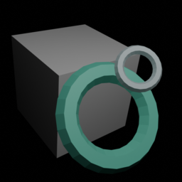
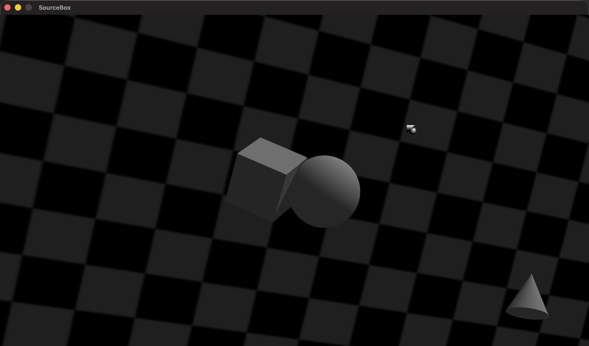

# SourceBox

<p align="center">
  
</p>

An application with Source Engine integration through VScript and Garry's Mod Lua scripting.


<p align="center">
  
</p>

> [!NOTE]
> Install the custom SRCBOX cube model into your game before spawning it from SourceBox.
> For Portal 2, Left 4 Dead 2 and legacy CS:GO, extract `models` and `materials` into `portal2`, `left4dead2` or `csgo`, respectively. For TF2, CS:S, Alien Swarm and Portal: Revolution, place the files in `custom/srcbox` inside the game folder.
> 
> You can download it [here!](https://github.com/Kiverix/srcbox.mdl/releases)

## Features
- **Python Bridge**: Spawn props directly from SourceBox into your game
- **Multi-game Support**: Works across most Source Engine games
- **Voidside PULL Mode**: Press **P** in the Voidside scene to hold the current target, silence the music, and show "P U L L". It also triggers automatically while a demo is playing in a Source game

### VScript Features (TF2 Branch Source Engine Games)
- **Picker (Aimbot)**: Advanced targeting system with priority targeting (Players → Props)
- **AWP Quit Trigger**: Shoot spawned SRCBOX props with AWP to quit the game (Only for CS:S)
- **Auto-Spawner**: Automatically spawns cube at random locations on map load
- **Auto-load Scripts**: Scripts automatically load on every map via `mapspawn.nut`

### Lua Features (Garry's Mod 9-13)
- **Automatic Addon Installation**: Creates addon structure in `addons/sourcebox/lua/`
- **Picker (Aimbot)**: Silent targeting system (NPCs → Players → Props)
- **Auto-Spawner**: Spawns cube on map load at random locations
- **Console Commands**: `picker_toggle`, `picker_next`, `sourcebox_spawn`

> [!NOTE]
> Picker aimbot script is little bit buggy on GMod 9.

## Supported Games

### VScript Support (Full Features)
| Game | VScript | Picker | AWP Quit | Auto-Spawn | Notes |
|------|---------|--------|----------|------------|-------|
| Team Fortress 2 | ✅ | ✅ | ✅ | ✅ | AWP Quit only for CS:S |
| Counter-Strike: Source | ✅ | ✅ | ✅ | ✅ | 
| Day of Defeat: Source | ✅ | ✅ | ✅ | ✅ | AWP Quit only for CS:S |
| Half-Life 2: Deathmatch | ✅ | ✅ | ✅ | ✅ | AWP Quit only for CS:S |
| Half-Life 1 Source: Deathmatch | ✅ | ✅ | ✅ | ✅ | AWP Quit only for CS:S |

### Mapbase Support (Enhanced VScript)
| Game/Mod | VScript | Picker | Auto-Spawn | Notes |
|----------|---------|--------|------------|-------|
| Entropy Zero 2 | ✅ | ✅ | ✅ | Standalone game |
| Raising the Bar: Redux | ✅ | ✅ | ✅ | Sourcemod |
| Any Mapbase mod | ✅ | ✅ | ✅ | Auto-detected |

> [!NOTE]
> Mapbase mods are automatically detected whether they're standalone games or sourcemods. The system checks for a `mapbase` folder in the game directory.

### Newer VScript Branches (Experimental)
| Game | VScript Bridge | Auto-Spawn | Picker | Notes |
|------|----------------|------------|--------|-------|
| Left 4 Dead 2 | ✅ | ✅ | ✅ | Server-side cube physics and Picker for the local survivor host. Commands through `left4dead2/ems/` |
| Portal 2 | ✅ | ✅ | Experimental | Single-player console controls. Precaches the custom cube on supported local maps and keeps the game's `mapspawn.nut` running |
| Portal 2: Community Edition | ✅ | ✅ | ❌ | Strata Source, auto-detected |
| Portal: Revolution | ✅ | ✅ | ❌ | Strata Source, auto-detected. Precaches the custom cube during map startup |
| Counter-Strike: Global Offensive | ✅ | ✅ | Experimental | Legacy CS:GO (`csgo.exe`). Cube physics on stock maps uses Stripper:Source |
| Alien Swarm | ✅ | ✅ | ❌ | Uses the first marine and precaches the custom cube on supported local maps |

> [!NOTE]
> SourceBox sets up these games while they are running. The bridge starts on the next map load. Cube spawning has been verified in all six games listed here.

For stock Portal 2 and Alien Swarm, start SourceBox before loading a fresh local map. SourceBox prepares an entity lump for each supported loose map so the game precaches the custom cube and can spawn it as a physics prop. SourceBox removes its files on exit. Maps with existing external entity overrides need their own compatible cube template.

In Portal: Revolution, SourceBox can also precache the model from the map-start script if the game ignores the entity lump. Start SourceBox before loading the map.

For 32-bit Windows legacy CS:GO, including CrossOver, SourceBox downloads and installs [Metamod:Source](https://www.metamodsource.net/downloads.php) and [Stripper:Source](https://github.com/alliedmodders/stripper-source/releases) when needed. Start the local game with `-insecure` for plugin support. If SourceBox installs the add-ons, restart CS:GO once with SourceBox still open. Then load a stock map and click the cube. SourceBox restores your Stripper configuration when it exits.

The standalone map copy is also available with `python -m sourcebox.bridges.cube_precache "/path/to/csgo" cs_office`. Load it with `map cs_office_sourcebox`.

> Portal 2, CS:GO, Alien Swarm and Strata can't read files from scripts, so SourceBox sends each command as a tiny script (`sourcebox_command.nut`) that the game re-runs, and spawn results show in the game console.
> Install the cube model for the game before trying to spawn it. Games that require a precached cube may skip spawning when the model or map template is missing.

On a local Left 4 Dead 2 campaign, type `!picker` in game chat to toggle aim lock and `!pickernext` to cycle visible targets. Picker applies to the host playing as a survivor and prioritizes infected, then teammates, then physics props. A target you choose with `!pickernext` stays selected while visible. The map must load the updated bridge once. After that you can restart SourceBox on the same map and turn Picker back on in chat.

To try the experimental Picker in stock Portal 2, start SourceBox and load a local single-player map. In the developer console, run `sv_cheats 1`, then `script PickerToggle()`. Picker prioritizes visible turrets, then cubes and other physics props. Use `script PickerNext()` to choose a target and `script PickerToggle()` again to release aim lock.

The experimental legacy CS:GO Picker uses the same console commands in a local practice match with one human player. It prioritizes visible enemy bots, then teammates, then physics props. In both games, a manual selection stays locked while the target remains visible.

### Garry's Mod Support (Lua Bridge)
| Version | Lua Bridge | Picker | Auto-Spawn | Notes |
|---------|------------|--------|------------|-------|
| GMod 9 | ✅ | ✅ | ✅ | Picker little bit buggy |
| GMod 10 | ✅ | ✅ | ✅ | Sourcemod |
| GMod 11 | ✅ | ✅ | ✅ | Sourcemod |
| GMod 12 | ✅ | ✅ | ✅ | Sourcemod |
| GMod 13 | ✅ | ✅ | ✅ | Retail install, 32-bit or 64-bit (`gmod_win64.exe`) |

### Console Injection (Legacy Support - Windows Only)
- Works with any Source mod without VScript support or Lua support
- Only cube spawning supported
- Brief window freeze during spawn
- **Linux not supported**

## Installation

### Option 1: Pre-built Executable (Recommended)
1. Download the latest release from [Releases](https://github.com/programmer1o1/sourcebox/releases)
2. Extract the ZIP file
3. **Important**: Launch your game **before** running SourceBox
4. Run `SourceBox.exe` (Windows) or `./SourceBox` (Linux)

### Option 2: Manual Installation

#### Prerequisites
- Python 3.7 or higher
- pip package manager
- A supported Source Engine game or Garry's Mod installed via Steam

#### Setup

1. Clone the repository:
```bash
git clone https://github.com/programmer1o1/sourcebox.git
cd sourcebox
```

2. Create a virtual environment (Linux):
```bash
python -m venv myenv
source myenv/bin/activate
```

3. Install dependencies:
```bash
pip install -r requirements.txt
```
> Note: This installs `pygame-ce` (imported as `pygame`). If you previously installed `pygame`, uninstall it first to avoid conflicts.

4. **Important**: Launch your game **before** running SourceBox

5. Run the application:
```bash
python Sourcebox.py
```

## Usage

### Controls

- **Left Click**: Interact with objects
  - **Cube**: Spawn SRCBOX cube in-game
  - **Sphere**: Toggle error scene
  - **Cone**: Enter Voidside tracker mode
- **P** (Voidside scene): Toggle PULL mode
- **ESC**: Exit application

### Source Engine Integration (VScript)

#### Automatic Setup
1. Launch a supported Source game (TF2, CS:S, DOD:S, HL2:DM, HL1S:DM) or any Mapbase mod
2. Launch SourceBox
3. Scripts automatically install to:
   - `game/scripts/vscripts/python_listener.nut`
   - `game/scripts/vscripts/picker.nut`
   - `game/scripts/vscripts/auto_spawner.nut`
   - `game/scripts/vscripts/vscript_server.nut` (Mapbase only)

**For Mapbase mods:**
- Files are stored in `vscript_io/` instead of `scriptdata/`
- Uses Mapbase-specific VScript API
- Auto-loads via `vscript_server.nut`

#### In-Game Usage

**Spawning Props:**
- Click the cube in SourceBox
- Prop spawns at your crosshair
- Works in single-player or local listen servers

**Picker Commands:**
```javascript
script PickerToggle()      // toggle aimbot on/off
script PickerNext()        // manually cycle to next target
```

You can also set binds like these
```
bind mouse4 "script PickerToggle()"
bind mouse5 "script PickerNext()"
bind kp_plus "script PickerToggle()"
```

**AWP Quit Feature:**
- Shoot any spawned SRCBOX cube with AWP
- Game quits immediately
- Only works in CS:S

**Manual Script Loading** (if auto-load fails):

**TF2 branch of Source Engine:**
```
sv_cheats 1
script_execute python_listener
```

**Mapbase:**
```
exec mapbase_default
script_execute vscript_server
```

### Garry's Mod Integration (Lua)

#### Automatic Setup
1. Launch GMod 9 (gmod9), 10 (garrysmod10classic), 11 (garrysmod), 12 (garrysmod12) (sourcemod version), or retail GMod 13 (GarrysMod/garrysmod)
2. Launch SourceBox
3. Addon automatically installs to:
   - `garrysmod/addons/sourcebox/lua/autorun/sourcebox_init.lua`
   - `garrysmod/addons/sourcebox/lua/autorun/sourcebox/sv_*.lua`
4. Restart GMod game to load addon on first install (Optional for GMod 9)

#### In-Game Usage

**Console Commands:**
```
picker_toggle              // toggle aimbot silently
picker_next               // cycle to next target
sourcebox_spawn <model> [distance]   // spawn any model
```

**Examples:**
```
picker_toggle
sourcebox_spawn props_junk/PopCan01a.mdl 300
sourcebox_spawn props/srcbox/srcbox.mdl
```

**Spawning Props:**
- Click the cube in SourceBox
- Prop spawns at crosshair
- Props are fully visible and interactive

### Legacy Console Injection

**Requirements:**
- Windows only
- Running Source mod detected automatically

**Spawning:**
- Click cube in SourceBox
- Console briefly opens, executes commands, closes
- Window may freeze for ~200ms
- Only SRCBOX cube supported

### CrossOver on macOS

The native macOS build scans CrossOver's configured private and published bottle
directories for Steam. It supports the file-based VScript and Garry's Mod Lua
bridges, including games launched through Wine/CrossOver command wrappers.

Legacy Windows console injection is not available from the native macOS build.
Install Steam and the Source game in a CrossOver bottle, launch the game first,
then start SourceBox.

#### Installing the macOS build

1. Unzip `SourceBox-macOS.zip` and move `SourceBox-macOS.app` to Applications.
2. Start Steam and the Source game inside CrossOver.
3. Open SourceBox. If macOS blocks the first launch, Control-click the app,
   choose **Open**, then confirm **Open**. Alternatively, use **Open Anyway** in
   System Settings > Privacy & Security.

The build is currently distributed without Apple notarization, so the first-launch
confirmation is expected. SourceBox writes startup and game-detection details to
`~/Library/Logs/SourceBox/sourcebox.log`.

## Troubleshooting

### Common Issues

**"No game configured" error:**
- Make sure game is running **before** launching SourceBox
- Check that game is installed via Steam
- Try restarting Steam
- On macOS, confirm Steam and the game are running in the same CrossOver bottle
- Check `~/Library/Logs/SourceBox/sourcebox.log` for the detected bottle and game

**Scripts not loading in Source games:**
- Type `sv_cheats 1` in console
- Manually run: `script_execute python_listener`

**GMod addon not working:**
- Make sure you're using GMod 9, 10, 11, or 12 (sourcemod)
- Restart GMod after first install
- Check `garrysmod/addons/sourcebox/` exists
- Use `lua_run include("autorun/sourcebox_init.lua")` to manually load

**AWP quit not working:**
- Only works in CS:S
- Must shoot SRCBOX cube specifically
- Requires AWP weapon

## Development

### Building from Source

```bash
# install development dependencies
pip install -r requirements.txt

# test bridges standalone
python source_bridge.py   # test source engine bridge
python gmod_bridge.py    # test gmod bridge

# run in verbose mode
python Sourcebox.py
```

### Compiling to Executable

**Windows:**
```bash
pip install pyinstaller
pyinstaller --onefile --windowed --name SourceBox ^
  --icon=assets/images/sourcebox.png ^
  --add-data "assets;assets" ^
  --add-data "bridge_scripts;bridge_scripts" ^
  --exclude-module pkg_resources ^
  --exclude-module setuptools ^
  --noupx --clean Sourcebox.py
```

**Linux:**
```bash
pip install pyinstaller
pyinstaller --onefile --windowed --name SourceBox \
  --icon=assets/images/sourcebox.png \
  --add-data "assets:assets" \
  --add-data "bridge_scripts:bridge_scripts" \
  --exclude-module pkg_resources \
  --exclude-module setuptools \
  --hidden-import=OpenGL.platform.glx \
  --hidden-import=OpenGL.arrays.vbo \
  --collect-all OpenGL \
  --noupx --clean Sourcebox.py
```

**macOS:**
```bash
pip install pyinstaller
pyinstaller --onedir --windowed --name SourceBox-macOS \
  --icon=assets/images/sourcebox.png \
  --add-data "assets:assets" \
  --add-data "bridge_scripts:bridge_scripts" \
  --hidden-import=OpenGL.platform.darwin \
  --hidden-import=OpenGL.arrays.vbo \
  --collect-all OpenGL \
  --noupx --clean Sourcebox.py
xattr -crs dist/SourceBox-macOS.app
codesign --verify --deep --strict dist/SourceBox-macOS.app
ditto -c -k --sequesterRsrc --keepParent \
  dist/SourceBox-macOS.app dist/SourceBox-macOS.zip
```

Output: `dist/SourceBox.exe` (Windows), `dist/SourceBox` (Linux), or
`dist/SourceBox-macOS.zip` (macOS).

### Adding Custom Models

**For Source Engine:**
1. Place models in `game/custom/yourmod/models/props/`
2. Spawn via Python:
```python
bridge.spawn("props/yourmod/model.mdl", 200)
```

**For Garry's Mod:**
```python
gmod_bridge.spawn_model("props/yourmod/model.mdl", 300)
```

Or in-game console:
```
sourcebox_spawn props/yourmod/model.mdl 300
```

## Technical Details

### VScript Communication
- **Method**: File I/O via `scriptdata/` folder
- **Files**: `python_command.txt`, `python_response.txt`
- **Format**: JSON with session ID and command counter
- **Rate**: Commands checked every 100ms

### Automatic Cleanup
- **What**: Everything SourceBox installs into a game (scripts, addon folders, command files) is removed when SourceBox closes, and any game file it replaced, such as Portal 2's `mapspawn.nut`, is restored
- **Killed or crashed**: A small background copy of SourceBox waits for it to exit and cleans up even after "End process" in Task Manager; anything still left is cleaned at the next start
- **Record**: `installed.json` (plus `backups/`) in SourceBox's log folder
- **Edited files**: A file you changed after SourceBox wrote it is left in place
- **In-game**: On the newer VScript branches the bridge stops polling as soon as its command file is gone, so closing SourceBox mid-map causes no console spam

### Demo Detection (PULL Mode)
- **Method**: A hidden worker process (SourceBox relaunched with `--demo-scan-worker`) checks Source game processes, found by their `steamapps` path plus `wineserver`, for open `.dem` files with `psutil` about once a second
- **Why a separate process**: `psutil` holds Python's global lock while listing open files, which would freeze rendering if it ran inside the app
- **Requirements**: No launch options or game-side script
- **Verified**: macOS with CrossOver (Counter-Strike: Source, Half-Life 2: Deathmatch); Windows and Linux are untested
- **Limitation**: Recording a demo also triggers PULL mode

### Mapbase VScript Communication
- **Method**: File I/O via `vscript_io/` folder (Mapbase-specific)
- **Files**: `python_command.txt`, `python_response.txt`
- **Format**: JSON with session ID and command counter
- **Rate**: Commands checked every 100ms
- **Detection**: Automatic via `mapbase/` folder presence

### Newer Branch VScript Communication
- **Games**: Left 4 Dead 2, Portal 2, CS:GO, Alien Swarm, Strata Source (P2CE, Portal: Revolution)
- **Script**: one shared `sourcebox_bridge.nut`, loaded from `mapspawn.nut` (`mapspawn_addon.nut` on L4D2)
- **L4D2**: JSON in `ems/sourcebox_command.txt`, results in `ems/sourcebox_response.txt`
- **Others**: JSON wrapped in `scripts/vscripts/sourcebox_command.nut`, re-run with `DoIncludeScript`; results print to the game console
- **Existing hooks**: a game's own `mapspawn.nut` is kept as `sourcebox_original_mapspawn.nut` and still runs first
- **Detection**: Strata games are recognised by the script runtime beside the launcher. Older Portal: Revolution builds use `vscript.dll` and are also recognised through the Steam library under CrossOver.
- **Rate**: Commands checked every 100ms

### Lua Communication (GMod)
- **Method**: File I/O via `data/` folder
- **Files**: `sourcebox_command.txt`, `sourcebox_response.txt`
- **Format**: JSON with session ID and command counter
- **Rate**: Commands checked every 100ms
- **Addon Path**: `addons/sourcebox/lua/autorun/`

### Console Injection (Legacy)
- **Method**: Windows API message sending
- **Process**: Freeze window → Open console → Paste command → Execute → Close console → Unfreeze
- **Limitation**: Windows only, visual freeze, cube only

## License

This project is licensed under the MIT License - see the LICENSE file for details.
